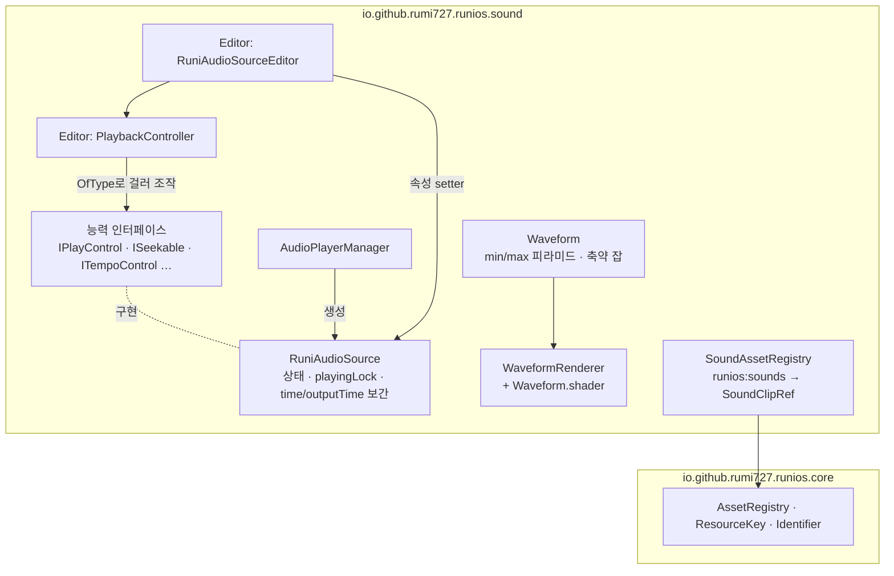

# Sound 패키지 작동 원리

> 기준 커밋: `3a2b24b9`. 코드 링크의 줄 번호는 이 커밋 기준입니다. 패키지 개요는 [패키지 README](../README.md)에 있습니다.

`io.github.rumi727.runios.sound`(어셈블리 `RuniOS.Sounds`, 에디터 `RuniOS.Editor.Sounds`)는 **특정 오디오 엔진에 묶이지 않는 재생 추상화**와 **파형 축약·렌더링**을 제공합니다.
실제 소리를 내는 일은 이 패키지를 상속하는 쪽이 맡습니다. 이 패키지는 그 위에서 공통으로 필요한 상태, 잠금, 시간 보간, 파형, 에디터 컨트롤을 담당합니다.
C#에 익숙하고 이 코드베이스는 처음인 독자를 기준으로 썼습니다.

## 한 장으로 보기

**핵심 아이디어 세 가지**

1. **능력을 작은 인터페이스로 나눕니다.** `IPlayControl`, `ISeekable`, `IPausable`처럼 능력마다 인터페이스가 있고, 모두 `IAudioPlayer`만 상속합니다. 소비자(예: 에디터 재생 컨트롤)는 대상을 필요한 능력으로 걸러 조작하므로, 종류가 다른 플레이어를 섞어 다룰 수 있습니다. → [1장](01-capability-interfaces.md)
2. **위치는 기준점에서 벽시계로 외삽합니다.** 엔진이 블록 단위로만 알려 주는 위치를 `(위치, Stopwatch 타임스탬프)` 기준점으로 저장하고, 읽을 때마다 `tempo` 기울기로 외삽합니다. 기준 타임스탬프를 미래로 잡으면 그때까지 위치가 유지되므로, "다음 블록부터 시작"을 별도 상태 없이 표현합니다. 모든 상태 변경은 `playingLock` 쓰기 잠금 안에서 기준점을 굳힌 뒤 일어납니다. → [2장](02-playback-state.md), [3장](03-time-interpolation.md)
3. **파형은 16개씩 묶는 min/max 피라미드로 줄이고, 줌에 따라 그리는 방식을 섞습니다.** 긴 구간도 레벨마다 양 끝 몇 개만 읽으면 되므로 열 하나의 비용이 길이와 거의 무관합니다. 셰이더는 확대 상태에서는 열마다 꺾은선을 복원해 선으로, 축소 상태에서는 밀도나 피크로 그리고, 그 사이는 픽셀당 샘플 수의 로그로 섞습니다. → [4장](04-waveform-pyramid.md), [5장](05-waveform-reduction.md), [6장](06-waveform-rendering.md)

## 읽는 순서

| 장 | 내용 | 깊이 |
| --- | --- | --- |
| [1. 능력 인터페이스](01-capability-interfaces.md) | 인터페이스 9개, 나누는 이유, 헷갈리기 쉬운 멤버 | 핵심만 |
| [2. 재생 상태와 명령](02-playback-state.md) | 플래그, `playingLock`, `Play`/`Stop`/`Pause`/`UnPause`, 훅, 잠금 규칙, 파생 클래스 예제 | **줄 단위** |
| [3. 시간 보간](03-time-interpolation.md) | `time`/`outputTime` 외삽, 미래 기준점, `ContinueOutputTimeUnsafe`, 기준점 메서드 | **줄 단위** |
| [4. 파형 피라미드](04-waveform-pyramid.md) | `Waveform` 생성, 레벨 배치, 생성 잡, `Dispose` | **줄 단위** |
| [5. 파형 축약](05-waveform-reduction.md) | `ScheduleMinMax`·`ScheduleApproximateMinMax`·`ScheduleResample`, `Reduce` | **줄 단위** |
| [6. 파형 렌더링](06-waveform-rendering.md) | `WaveformRenderer.Render`, 텍스처 배치, 셰이더의 선·밀도·피크 | **줄 단위** |
| [7. 리소스와 생성](07-resources.md) | `SoundClipRef`, `SoundAssetRegistry`, `AudioSpatialState`, `IAudioClip`, `AudioPlayerManager` | 요약 |
| [8. 에디터](08-editor.md) | `PlaybackController`, 기능 플래그, 반복 핸들, 시간 단위, 인스펙터 | 요약 + 핵심 메서드 |

**연관 패키지** (이 패키지가 의존하는 것)

| 패키지 | 이 패키지에서 쓰는 부분 |
| --- | --- |
| `io.github.rumi727.runios.core` | `ResourceKey`, `Identifier`, `AssetRegistry`(`BeginTracking`/`EndTracking`), `MathUtility`(`Clamp`, `Max`), 수명 주기 특성 |
| `io.github.rumi727.runios.core.editor` | `CustomInspectorBase`(`EditPropertyValue`), `PackDrawer`, IMGUI 도구 |
| `com.unity.burst`, `com.unity.mathematics` | 파형 잡 |

## 용어집

| 용어 | 뜻 |
| --- | --- |
| **능력 인터페이스** | `IAudioPlayer`를 상속하는 작은 인터페이스. 플레이어가 할 수 있는 일 하나를 나타냅니다. |
| **진행 중** | `isPlaying && !isPaused`. 이때만 `time`/`outputTime`이 벽시계로 외삽됩니다. |
| **기준점** | `(baseTime, baseTimestamp)`: "이 벽시계 시각에 위치는 이 값이었다". `outputTime`에도 따로 있습니다. |
| **미래 기준점** | 타임스탬프가 지금보다 뒤인 기준점. 그 시각까지 위치가 유지됩니다(`Clamp(0)`). |
| **`time` / `outputTime`** | 엔진이 계산한 위치 / 지금 출력되고 있는 위치 |
| **타임스탬프** | `Stopwatch.GetTimestamp()` 값. `Stopwatch.Frequency` 틱 = 1초 |
| **훅** | `OnPlay`/`OnStop`/`OnPause`/`OnUnPause`. 쓰기 잠금을 보유한 채 불립니다. |
| **planar 샘플** | 채널마다 연속으로 놓은 샘플 배열 `[channel * sampleCount + sample]` |
| **레벨 / 노드** | 피라미드의 층 / 층의 원소. 레벨 l의 노드 하나는 원본 `16^(l+1)`샘플의 `(min, max)` |
| **열** | 축약 결과의 한 칸. 렌더러에서는 픽셀 열 하나 |
| **scale** | 열 하나가 덮는 샘플 수(소수). 렌더러에서는 픽셀당 샘플 수(`samplesPerPixel`) |
| **빈 열** | `min > max`인 결과. 샘플이 없는 파형에서 나옵니다. |
| **하위 열** | 밀도 방식에서 픽셀 하나를 나눈 칸(1~16개) |
| **선 / 밀도 / 피크** | 셰이더의 세 그리기 방식. 확대 상태 / 축소 상태(기본) / 축소 상태(대안) |

## 파일 지도

| 영역 | 파일 |
| --- | --- |
| 능력 인터페이스 (`Runtime/Sounds`) | `IAudioPlayer`, `IPlayControl`, `IStoppable`, `IPausable`, `ISeekable`, `ILoopControl`, `ITempoControl`, `IPitchControl`, `IAudioEmitter` |
| 재생 소스 (`Runtime/Sounds`) | `RuniAudioSource` |
| 파형 (`Runtime/Sounds`) | `Waveform`(.BuildFromSamplesJob / .BuildFromLevelJob / .MinMaxJob / .ApproximateMinMaxJob / .ResampleJob), `WaveformRenderer`, `WaveformRenderMode` |
| 셰이더 (`Resources/RuniOS/Sounds`) | `Waveform.shader` (`Hidden/RuniOS/Waveform`) |
| 값과 계약 (`Runtime/Sounds`) | `AudioSpatialState`, `IAudioClip`, `SoundClipRef`, `AudioPlayerManager` |
| 리소스 (`Runtime/Resource/Sounds`) | `SoundAssetRegistry`(`runios:sounds`) |
| 에디터 IMGUI (`Editor/IMGUI/Sounds`) | `PlaybackController`, `PlaybackControllerFeatures`, `ITimeUnit`, ``ITimeUnit`1``, `GenericTimeUnit` |
| 에디터 인스펙터 (`Editor/Unity/Drawers/Sounds`) | `RuniAudioSourceEditor<TTarget>`, `RuniAudioSourceDefaultEditor` |
| 에디터 리소스 (`Editor/Resource/Sounds`) | `RuniAudioClipPackDrawer<T>` |

## 그림 목록

| 그림 | 장 |
| --- | --- |
| [RuniAudioSource 시간 보간](images/time-interpolation.svg) | 3 |
| [min/max 피라미드의 배치](images/waveform-pyramid.svg) | 4 |
| [Reduce: 정렬되지 않은 양 끝만 소비하고 위 레벨로](images/waveform-reduce.svg) | 5 |
| [정확한 축약과 근사 축약](images/waveform-columns.svg) | 5 |
| [줌에 따른 그리기 방식](images/waveform-blend.svg) | 6 |
| [LineAlpha: 열 하나를 꺾은선 3개로 복원](images/waveform-line.svg) | 6 |
