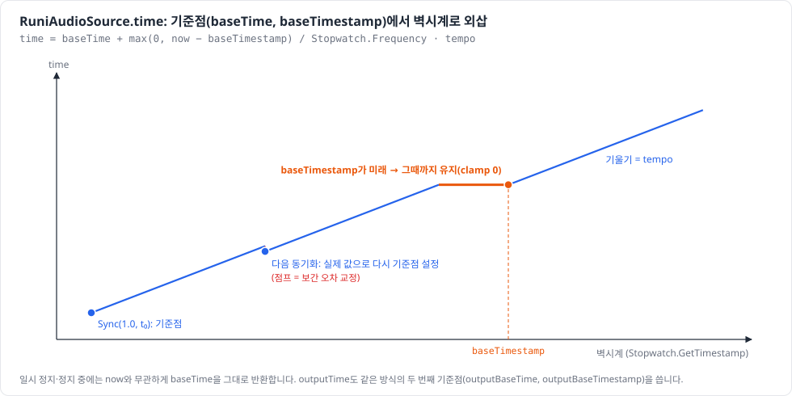
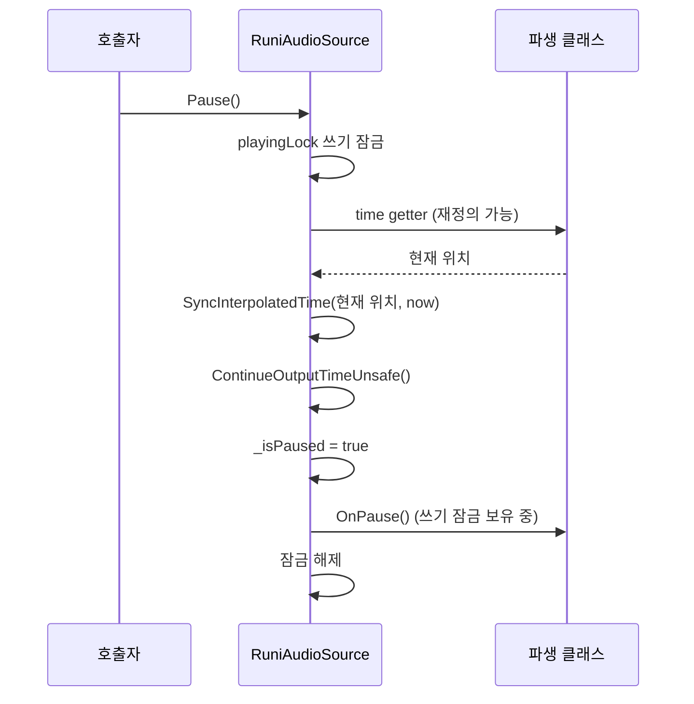

# RuniAudioSource 시간 보간

> 기준 커밋: `440c549c`. [← Sound 문서 목차](README.md)

오디오 엔진은 재생 위치를 보통 **블록 단위로만** 알려 줍니다(예: 1024 샘플, 48 kHz에서 약 21 ms마다).
그 값을 화면에 그대로 쓰면 플레이헤드가 계단처럼 움직입니다. `RuniAudioSource`는 **마지막으로 알고 있는 위치와 그 위치의 벽시계 시각**을 기준점으로 저장해 두고, 읽을 때마다 벽시계로 외삽합니다.

- 파생 클래스는 엔진에서 새 위치를 알게 될 때마다 기준점만 다시 잡습니다.
- 소비자는 `time` / `outputTime`을 언제든 읽어 매끄러운 값을 얻습니다.



## 1. 상태

| 필드 | 의미 |
| --- | --- |
| `baseTime`, `baseTimestamp` | `time`의 기준점: "벽시계 `baseTimestamp`에 위치는 `baseTime`이었다" |
| `outputBaseTime`, `outputBaseTimestamp` | `outputTime`의 기준점 |
| `_isPlaying`, `_isPaused` | 재생 상태. 진행 중이란 `_isPlaying && !_isPaused`를 뜻합니다. |
| `_tempo` | 진행 속도(부호 있음) |
| [`playingLock`](../Runtime/Sounds/RuniAudioSource.cs#L24) | `ReaderWriterLockSlim(SupportsRecursion)`. 위 상태를 모두 보호하며, **public**이라 파생 클래스와 외부 코드도 같은 잠금을 씁니다. |

타임스탬프 단위는 `System.Diagnostics.Stopwatch` 틱입니다(`Stopwatch.Frequency` 틱 = 1초).

## 2. `time` getter (줄 단위)

```csharp
101  public virtual double time
     {
         get
         {
105          playingLock.EnterReadLock();
             try
             {
110              if (_isPlaying && !_isPaused)                                               // ① 진행 중일 때만 외삽
111                  return baseTime + (((Stopwatch.GetTimestamp() - baseTimestamp).Clamp(0)   // ② 경과 틱, 음수면 0
                                         / (double)Stopwatch.Frequency) * tempo);            // ③ 초 × tempo
                 else
113                  return baseTime;                                                        // ④ 정지·일시 정지는 고정
             }
             finally { playingLock.ExitReadLock(); }
         }
120      set => SyncInterpolatedTime(value);                                                 // ⑤ 대입 = 지금 기준점 재설정
     }
```

1. ② **`Clamp(0)`가 이 설계의 핵심**입니다. 기준 타임스탬프를 **미래**로 잡을 수 있습니다. 그러면 그 시각이 될 때까지 경과가 0으로 잘려 **위치가 유지**됩니다.
   - "명령은 지금 받았지만 효과는 오디오가 다음 블록에 도달할 때 시작된다"는 상황을 별도 상태 없이 표현할 수 있습니다.
   - `long.MaxValue`를 넣으면 영원히 유지합니다.
2. ③ `tempo`가 음수면 시간이 거꾸로 흐릅니다. 0이면 멈춥니다.
3. 반복 구간으로 되돌리는 처리(loop wrap)는 하지 않습니다. 필요하면 파생 클래스가 getter를 재정의합니다.

## 3. `outputTime`

`time`은 "엔진이 **계산한** 위치"입니다. 그 소리가 스피커에서 나오기까지는 출력 버퍼만큼 더 걸립니다. `outputTime`은 "**지금 들리는** 위치"를 위한 두 번째 기준점입니다.

```csharp
558  double GetInterpolatedOutputTimeUnsafe(long timestamp)
     {
560      if (_isPlaying && !_isPaused)
561          return outputBaseTime + (((timestamp - outputBaseTimestamp).Clamp(0) / (double)Stopwatch.Frequency) * tempo);
         else
563          return outputBaseTime;
     }
```

같은 외삽 규칙을 씁니다. 기준점은 파생 클래스가 [`SyncInterpolatedOutputTime(time, timestamp)`](../Runtime/Sounds/RuniAudioSource.cs#L542)으로 잡습니다. 파생 클래스가 아무것도 하지 않으면 `outputTime`은 기본 규칙(아래 4절)만 따라갑니다.

### `ContinueOutputTimeUnsafe`: 상태가 바뀌어도 이어지게

```csharp
575  void ContinueOutputTimeUnsafe()
     {
577      long timestamp = Max(Stopwatch.GetTimestamp(), outputBaseTimestamp);   // ① 지금, 단 기준이 미래면 그 미래
578      outputBaseTime = GetInterpolatedOutputTimeUnsafe(timestamp);           // ② 그 시점의 값을 계산해서
579      outputBaseTimestamp = timestamp;                                       // ③ 새 기준점으로 고정
     }
```

`tempo`, 일시 정지 같은 **외삽 규칙을 바꾸기 직전**에 호출합니다. 바뀌기 전 규칙으로 현재 값을 계산해 기준점으로 굳혀 두므로, 규칙이 바뀌어도 값이 튀지 않습니다.
① 기준이 미래면 그 미래를 유지합니다. 아직 진행이 시작되지 않은 "유지 구간"이 상태 변경 때문에 사라지지 않게 하기 위해서입니다.

## 4. 명령마다 기준점이 어떻게 바뀌는가

| 명령 | 줄 | 동작 순서 (모두 `playingLock` 쓰기 잠금 안) |
| --- | --- | --- |
| `Play(start)` | [#L333](../Runtime/Sounds/RuniAudioSource.cs#L333) | `isActiveAndEnabled`가 아니면 무시 → `ContinueOutputTimeUnsafe` → `_isPlaying = true` → **`time = start`**(가상 setter) → `OnPlay()` |
| `Stop()` | [#L372](../Runtime/Sounds/RuniAudioSource.cs#L372) | `_isPlaying = false` → **`time = 0`** → `SyncInterpolatedOutputTime(0, now)` → `OnStop()` |
| `Pause()` | [#L408](../Runtime/Sounds/RuniAudioSource.cs#L408) | `SyncInterpolatedTime(time)`(현재 값을 굳힘) → `ContinueOutputTimeUnsafe` → `_isPaused = true` → `OnPause()` |
| `UnPause()` | [#L444](../Runtime/Sounds/RuniAudioSource.cs#L444) | `SyncInterpolatedTime(time)`(정지 값, 지금 시각) → `ContinueOutputTimeUnsafe` → `_isPaused = false` → `OnUnPause()` |
| `tempo = v` | [#L187](../Runtime/Sounds/RuniAudioSource.cs#L187) | `SyncInterpolatedTime(time)` → `ContinueOutputTimeUnsafe` → `_tempo = v` |
| `time = v` | [#L120](../Runtime/Sounds/RuniAudioSource.cs#L120) | `SyncInterpolatedTime(v)` (지금 기준) |
| `OnDisable` | [#L612](../Runtime/Sounds/RuniAudioSource.cs#L612) | `_isActiveAndEnabled = false` → `Stop()` |

알아 둘 점:

- `Pause`/`UnPause`/`tempo`의 `SyncInterpolatedTime(time)`은 **가상 `time` getter**를 거칩니다. 파생 클래스가 getter를 재정의했다면(예: 반복 구간으로 되돌리기) 그 값이 기준점이 됩니다.
- `Play`와 `Stop`이 `time`을 **대입**한다는 점도 중요합니다. 파생 클래스가 `time` setter에서 "엔진 위치 이동 + 소리 다시 시작"을 하면, 재생 시작과 정지에도 그 처리가 그대로 적용됩니다.
- `Play`는 `_isPaused`를 바꾸지 않고, `Stop`도 `_isPaused`를 지우지 않습니다.



## 5. 파생 클래스 계약

파생 클래스가 할 일은 하나입니다. 엔진에서 "확실한 위치"를 알게 될 때마다 기준점을 다시 잡는 것입니다.

```csharp
// 엔진이 위치 p를 "벽시계 t에 계산했다"는 것을 알았을 때
SyncInterpolatedTime(p, t);                 // time의 기준점
SyncInterpolatedOutputTime(p − 지연·tempo, t); // outputTime의 기준점 (지연을 알 때)
```

- `t`를 **"내가 그 값을 발견한 시각"이 아니라 "엔진이 그 값을 만든 시각"**으로 넘기면, 갱신 주기가 불규칙해도 기울기가 정확합니다.
- `t`를 미래로 넘기면 그 시각까지 위치가 유지됩니다. 예약된 시작처럼 "효과가 나중에 나는 명령"에 씁니다.
- 두 메서드는 내부에서 쓰기 잠금을 잡습니다. 잠금이 재귀를 허용하므로, 이미 `playingLock`을 잡은 상태에서 불러도 됩니다.
- `OnPlay`/`OnStop`/`OnPause`/`OnUnPause`는 쓰기 잠금을 보유한 채 불립니다. 이 안에서 **다른 스레드가 `playingLock`을 기다리며 쥐고 있는 자원**을 기다리면 교착 상태가 됩니다.
