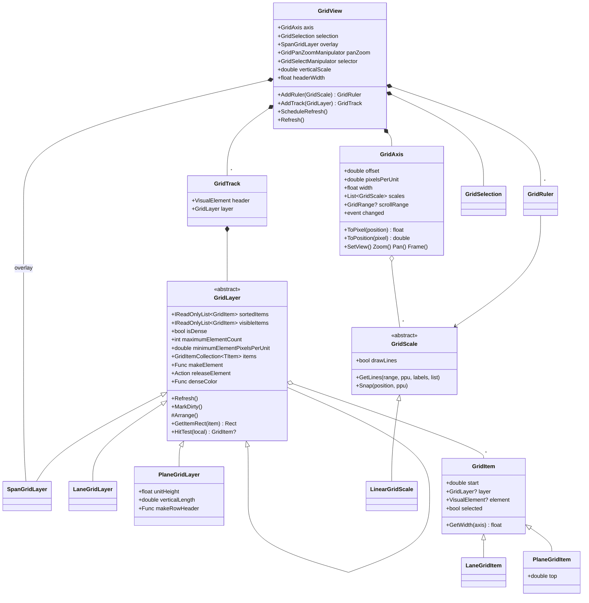
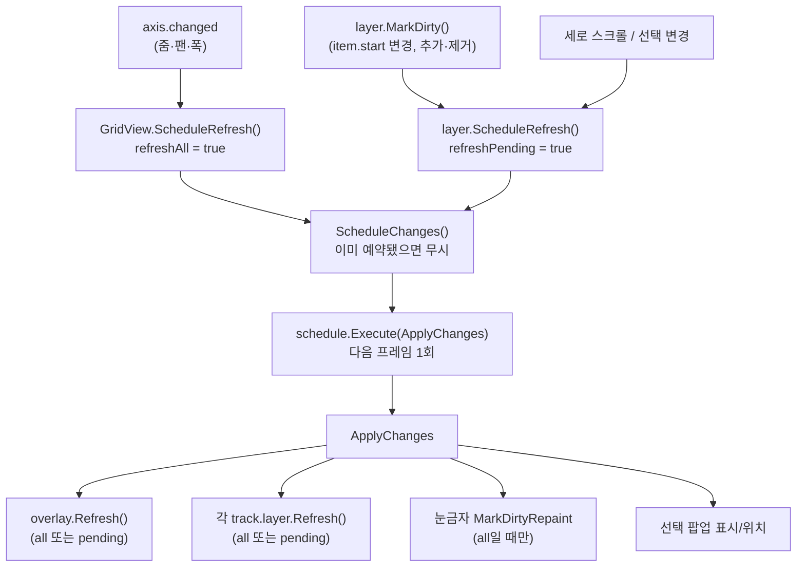

# Grids: 범용 타임라인 그리드 프레임워크

> 기준 커밋: `440c549c`. 코드 링크의 줄 번호는 이 커밋 기준입니다.

`RuniOS.UIElements.Grids`는 UI Toolkit 위에서 **가로축은 연속 값(시간·tick 등), 세로축은 트랙/행**인 편집기형 그리드를 만드는 프레임워크입니다. 피아노 롤, 노트 그리드, 타임라인, 마커 레인을 같은 구성 요소로 조립합니다.
수만 개의 아이템을 다루기 위해 다음 세 가지를 기본으로 갖춥니다.

- **가상화:** 보이는 아이템만 다룹니다.
- **dense 모드:** 너무 많거나 너무 작으면 요소 대신 메시를 그립니다.
- **갱신 병합:** 프레임당 한 번만 다시 그립니다.

- [1. 구성 요소](#1-구성-요소)
- [2. 좌표 모델](#2-좌표-모델)
- [3. 아이템과 레이어](#3-아이템과-레이어)
- [4. 갱신 파이프라인](#4-갱신-파이프라인)
- [5. `GridLayer.Refresh`: 가상화 (줄 단위)](#5-gridlayerrefresh-가상화-줄-단위)
- [6. 그리기: 선과 dense 아이템](#6-그리기-선과-dense-아이템)
- [7. 스케일과 눈금자](#7-스케일과-눈금자)
- [8. 입력: 매니퓰레이터와 히트 테스트](#8-입력-매니퓰레이터와-히트-테스트)
- [9. 사용 예](#9-사용-예)

---

## 1. 구성 요소



`GridView`의 요소 계층([`GridView()`](../../Runtime/UIElements/Grids/GridView.cs#L100)):

```text
GridView
├─ viewport (focusable, 매니퓰레이터가 붙는 곳)
│  ├─ top
│  │  ├─ corner              (headerWidth 폭)
│  │  └─ rulers              (GridRuler들)
│  ├─ scroll-view (세로 스크롤)
│  │  └─ content = GridTrack들 ← GridView.contentContainer, AddTrack이 여기에 추가
│  │     └─ GridTrack: header + layer
│  ├─ overlay (SpanGridLayer, 입력 무시) ← 재생 헤드, 반복 구간 등 트랙 전체를 덮는 것
│  └─ marquee                (상자 선택 사각형)
├─ horizontal range slider   (axis.scrollRange가 있을 때)
└─ popup-layer               (GridPopup들)
```

## 2. 좌표 모델

**가로축은 하나**이고 모든 트랙·눈금자·오버레이가 공유합니다. [`GridAxis`](../../Runtime/UIElements/Grids/GridAxis.cs)에 정의되어 있습니다.

```csharp
119  public float ToPixel(double position) => (float)((position - offset) * pixelsPerUnit);
133  public double ToPosition(float pixel) => offset + (pixel / pixelsPerUnit);
143  public GridRange GetRange() => new(offset, offset + (width / pixelsPerUnit));   // 보이는 범위
```

- 단위는 소비자가 정합니다. 초, tick, 샘플 무엇이든 됩니다.
- `offset`: 왼쪽 끝(헤더 바로 오른쪽)의 값입니다.
- `pixelsPerUnit`: 확대 배율입니다. `[minimumPixelsPerUnit, maximumPixelsPerUnit]`로 제한합니다.
- `width`: 뷰포트 폭에서 `headerWidth`를 뺀 값입니다. `GridView.UpdateLayout`이 맞춥니다.

| 조작 | 식 |
| --- | --- |
| `Zoom(factor, anchorPixel)` | 앵커 픽셀 아래의 값을 고정하고 배율만 바꿉니다: `offset' = anchor − anchorPixel / ppu'` |
| `Pan(pixels)` | `offset' = offset − pixels / ppu` |
| `Frame(range)` | `offset = range.start`, `ppu = width / range.length` |

값이 바뀌면 `changed` 이벤트가 발생하고, `GridView`가 **전체 갱신**을 예약합니다.

**세로축은 레이어마다 따로** 정합니다. 세로 스크롤은 `ScrollView`가, 세로 확대는 `GridView.verticalScale`이 맡습니다. `PlaneGridLayer`와 `LaneGridLayer`는 높이에 이 값을 곱합니다.

| 레이어 | 아이템 사각형 (`GetItemRect`) |
| --- | --- |
| `SpanGridLayer` | `(x, 0, width, layer.height)`: 레이어 높이 전체. 재생 헤드, 구간, 마커용 |
| `LaneGridLayer` | 겹치지 않도록 탐욕적으로 고른 레인 × `laneHeight · verticalScale`. 레이어 높이는 레인 수만큼 늘어납니다. |
| `PlaneGridLayer` | `(x, item.top · unitHeight · verticalScale, width, 요소 높이 또는 한 행)`. 행 헤더와 행 구분선이 있습니다. |

가로 `x`, `width`는 모두 [`GetHorizontalPixels`](../../Runtime/UIElements/Grids/GridLayer.cs#L294)에서 나옵니다. 폭은 `item.GetWidth(axis)`가 NaN이 아니면 그 값을 쓰고, 그렇지 않으면 그려진 요소의 폭, 그것도 없으면 `defaultItemWidth`를 씁니다. 그래서 USS로 크기를 정한 요소도 다룰 수 있습니다.

## 3. 아이템과 레이어

- [`GridItem`](../../Runtime/UIElements/Grids/GridItem.cs)은 **데이터가 아니라 위치 핸들**입니다. `start`(가로 위치), 선택적 폭, 소속 레이어, 현재 붙어 있는 요소만 가집니다. 소비자는 상속해서 자기 데이터를 붙입니다.
- `start`를 바꾸면 `layer.MarkDirty()`가 불리고 다음 프레임에 재정렬됩니다.
- [`GridItemCollection<TItem>`](../../Runtime/UIElements/Grids/GridItemCollection%601.cs)은 추가 순서를 유지하는 목록입니다. 아이템은 한 컬렉션에만 속할 수 있습니다. 대량 제거는 `RemoveAll`로 합니다.
- 레이어는 이와 별도로 **`start` 순으로 정렬된 목록**(`sortedItems`)을 가집니다.
- [`GridSelection`](../../Runtime/UIElements/Grids/GridSelection.cs)은 그리드 전체가 공유하는 선택 집합입니다. 여러 개를 바꾸는 메서드도 `changed`를 한 번만 발생시킵니다.

**요소 풀링은 소비자 몫입니다.**

```csharp
layer.makeElement    = item => pool.Count > 0 ? pool.Pop() : new MyElement();   // 보이게 될 때
layer.releaseElement = (item, element) => pool.Push(element);                  // 안 보이게 될 때
layer.denseColor     = item => item.color;                                     // dense 모드 색 (선택)
```

`makeElement`가 `null`이면 그 레이어는 항상 dense 모드(메시)로 그립니다.

## 4. 갱신 파이프라인



- 같은 프레임에 아무리 여러 번 요청해도 `ApplyChanges`는 **한 번** 실행됩니다([`ScheduleChanges`](../../Runtime/UIElements/Grids/GridView.cs#L412)).
- 축이 바뀌면 모든 레이어와 눈금자를 갱신합니다. 아이템 하나가 바뀌면 그 레이어만 갱신합니다. 예를 들어 재생 헤드만 움직일 때는 overlay만 갱신됩니다.
- [`ApplyChanges`](../../Runtime/UIElements/Grids/GridView.cs#L433)는 재생 중 매 프레임 돌 수 있으므로, LINQ 속성(`tracks`, `layers`) 대신 인덱스로 자식을 순회합니다.

## 5. `GridLayer.Refresh`: 가상화 (줄 단위)

```csharp
// GridLayer.cs
553  public void Refresh()
     {
556      refreshPending = false;                                   // ① 먼저 내림: 갱신 도중 생긴 변경은 다음 프레임에
557      if (view is not { } gridView) return;
560      if (addedItems.Count > 0 || removedItems.Count > 0)
561          ApplyAddedAndRemovedItems(gridView);                  // ② 추가·제거를 한꺼번에 반영 (추가분은 끝에 붙임)
563      GridAxis axis = gridView.axis;
564      bool zoomChanged = !axis.pixelsPerUnit.Approximately(arrangedPixelsPerUnit);
565      if (dirty)
566          SortByStart(CollectionsMarshal.AsSpan(sorted));       // ③ 적응형 삽입 정렬 (안정, 예산 초과 시 Span.Sort)
569      if (dirty || zoomChanged)                                 // ④ 가장 넓은 아이템 폭(축 단위)
         {
571          maximumReach = 0;
573              maximumReach = Math.Max(maximumReach, GetItemWidth(sorted[i], axis) / axis.pixelsPerUnit);
         }
577      if (dirty || (zoomChanged && arrangesWithZoom) || (verticalScaleChanged && arrangesWithVerticalScale))
578          Arrange();                                            // ⑤ 레이어별 배치 (레인 계산, 높이)
584      Rect clip = gridView.viewport.worldBound;                 // ⑥ 세로로 보이는 구간
586      float top = Math.Max(0, clip.yMin - bounds.yMin);
587      float bottom = Math.Min(bounds.height, clip.yMax - bounds.yMin);
589      nextVisible.Clear();
590      if (bottom > top)
591          CollectVisible(gridView.axis.GetRange(), top, bottom, nextVisible);   // ⑦ 가로 이진 탐색 + 세로 컬링
593      bool useElements = usesElements && nextVisible.Count <= maximumElementCount
                            && axis.pixelsPerUnit >= minimumElementPixelsPerUnit;   // ⑧ element 모드 vs dense 모드
600      for (… visibleList …)                                     // ⑨ 더 이상 안 보이는 요소 반납
603          if (item.element != null && item.layer == this && (!useElements || !nextVisibleSet.Contains(item)))
604              ReleaseItemElement(item);
607      if (useElements)
609          for (… nextVisible …)
             {
612              if (item.element == null) MakeItemElement(item);  // ⑩ 새로 보이는 것만 요소 생성
615              UpdateItemElement(item);                          //    style.translate로 위치, 선택 클래스
             }
619      (visibleList, nextVisible) = (nextVisible, visibleList);  // ⑪ 두 버퍼 교대 (할당 없음)
623      isDense = !useElements;
626      MarkDirtyRepaint();                                       // ⑫ 선 + (dense면) 아이템 메시
     }
```

1. ③ 정렬은 [`SortByStart`](../../Runtime/UIElements/Grids/GridLayer.cs#L660)입니다. 아이템은 보통 이미 정렬되어 있고 편집은 몇 개만 옮기므로 삽입 정렬이 거의 한 번에 끝납니다. **같은 start의 순서를 유지**하므로, 바뀌지 않은 아이템이 갱신마다 자리를 바꾸지 않습니다.
2. ④⑦ [`CollectRange`](../../Runtime/UIElements/Grids/GridLayer.cs#L358)는 `start ≥ range.start − maximumReach`인 첫 아이템을 이진 탐색으로 찾고, `start ≤ range.end`인 동안 순회합니다. 왼쪽 밖에서 시작했지만 폭이 넓어 화면에 걸친 아이템도 `maximumReach` 덕분에 빠지지 않습니다. 비용은 `O(log n + 보이는 수)`입니다.
3. ⑧ 보이는 아이템이 `maximumElementCount`(기본 2000)를 넘거나, 확대 배율이 `minimumElementPixelsPerUnit`보다 작으면 **요소를 모두 반납하고 메시로만** 그립니다. 축소해서 곡 전체를 볼 때도 UI 요소 수가 폭발하지 않습니다.
4. ⑩ 요소 위치는 `style.translate`로만 옮깁니다. 레이아웃을 다시 계산하지 않아도 됩니다. 폭을 아이템이 정하지 않는 요소(NaN)는 `GeometryChangedEvent`로 실제 크기를 잰 뒤 다시 배치합니다.
5. ⑪ 할당을 피하려고 두 리스트를 교대로 씁니다.

## 6. 그리기: 선과 dense 아이템

[`OnGenerateVisualContent`](../../Runtime/UIElements/Grids/GridLayer.Drawing.cs#L47)는 사각형 목록 하나를 만들어 한 번에 메시로 씁니다.

1. 축의 각 스케일이 보이는 범위의 선을 줍니다(`GetLines`). 선마다 폭 1픽셀 사각형이며, 단계별 색은 USS `--runios-grid-line-color-0/1/2`입니다.
2. 행 구분선(`AddRowLines`, `PlaneGridLayer`)을 그립니다.
3. dense 모드면 보이는 아이템마다 사각형을 그립니다(최소 1×1픽셀). **같은 행·같은 색이고 1픽셀 안으로 붙은 아이템은 사각형 하나로 합칩니다.** 아이템이 start순이라 행마다 "마지막 사각형"만 보면 됩니다. 병합은 아이템 사이 거리로만 정하므로 스크롤해도 병합 결과가 바뀌지 않습니다.
4. [`GridMeshUtility.DrawRects`](../../Runtime/UIElements/Grids/GridMeshUtility.cs#L28)가 사각형을 정점 4개·인덱스 6개로 직접 씁니다. 16비트 인덱스 한계 때문에 메시 하나에 최대 `65535/4`개씩 나눠 할당합니다. 투명한 사각형은 건너뜁니다.

모든 버퍼(`rectBuffer`, `lineBuffer`, `denseRuns`)는 필드에 두고 재사용합니다. 그리기는 hot path이기 때문입니다.

## 7. 스케일과 눈금자

- [`GridScale`](../../Runtime/UIElements/Grids/GridScale.cs): `GetLines(range, ppu, includeLabels, list)`와 `Snap(position, ppu)`를 구현하는 추상 클래스입니다. `GridLine(position, level, label?)`의 `level`은 0=강한 선(마디), 1=기본, 2=보조입니다.
- `axis.scales`에 넣은 스케일이 **레이어의 선과 스냅**을 정합니다. 스냅은 `axis.snap` 함수가 있으면 그것을, 없으면 첫 스케일을 씁니다. `GridView.Snap`은 `snapBypassModifier`(기본 Shift)를 누르면 스냅을 건너뜁니다.
- [`LinearGridScale`](../../Runtime/UIElements/Grids/LinearGridScale.cs)은 등간격입니다. 선 사이가 `minimumSpacing` 픽셀 이상이 되도록 간격을 **2의 거듭제곱 배**로 고릅니다.

  `step = unit · 2^⌈log₂(minimumSpacing / (unit · ppu))⌉`

- [`GridRuler`](../../Runtime/UIElements/Grids/GridRuler.cs)는 스케일 하나의 선(0단계 전체 높이, 1단계 절반, 2단계 4분의 1)과 라벨을 위쪽 띠에 그립니다. 축의 스케일과 무관하게 여러 개를 둘 수 있습니다(예: 초 + 마디).

## 8. 입력: 매니퓰레이터와 히트 테스트

| 매니퓰레이터 | 동작 |
| --- | --- |
| [`GridPanZoomManipulator`](../../Runtime/UIElements/Grids/GridPanZoomManipulator.cs) | 휠로 포인터 기준 가로 확대·축소(또는 수정 키 조합에 따라 세로 스크롤·세로 확대)와 끌기 이동 |
| [`GridSelectManipulator`](../../Runtime/UIElements/Grids/GridSelectManipulator.cs) | 클릭 선택·전환, 상자 선택(marquee), 선택 아이템 끌어 옮기기. 각 단계에서 이벤트를 **먼저** 발생시켜 기본 동작을 바꿀 수 있습니다. 이동 결과는 `GridMoveResult(entries, delta, verticalDelta)`로 받습니다. |
| [`GridEditKeyManipulator`](../../Runtime/UIElements/Grids/GridEditKeyManipulator.cs) (선택) | Delete / Ctrl+C / Ctrl+V를 `deleting`·`copying`·`pasting` 이벤트로 바꿉니다. 데이터는 바꾸지 않습니다. |

- 포인터 위치는 [`CreatePointerArgs`](../../Runtime/UIElements/Grids/GridView.Pointer.cs#L54)가 `GridPointerArgs`로 풉니다. 축 위치, 트랙, 레이어, 아이템이 들어 있습니다.
- 아이템은 [`GridLayer.HitTest`](../../Runtime/UIElements/Grids/GridLayer.cs#L445)로 찾습니다. 그 위치의 범위 쿼리를 하고, 위에 그려진 것(나중 것)부터 사각형 포함 여부를 검사합니다.
- `readOnly`면 편집 동작과 대부분의 팝업이 비활성화됩니다.

## 9. 사용 예

```csharp
GridView grid = new() { headerWidth = 120 };
LinearGridScale beats = new() { unit = 4, majorInterval = 4 };   // 4 tick = 1박, 4박 = 1마디
grid.axis.scales.Add(beats);                                     // 선 + 스냅
grid.AddRuler(beats);                                            // 위쪽 눈금자

PlaneGridLayer notes = new() { unitHeight = 18, verticalLength = layerCount };
notes.makeElement = item => pool.Count > 0 ? pool.Pop() : new NoteElement();
notes.releaseElement = (item, element) => pool.Push(element);
grid.AddTrack(notes);

foreach (Note note in song)
    notes.items.Add(new NoteItem(note) { start = note.tick, top = note.layer });

GridItem playhead = new();
grid.overlay.items.Add(playhead);
grid.schedule.Execute(() => playhead.start = player.tick).Every(0);   // overlay만 갱신
```
